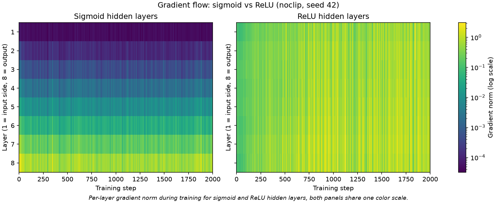
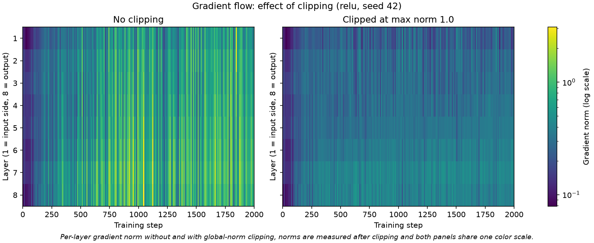
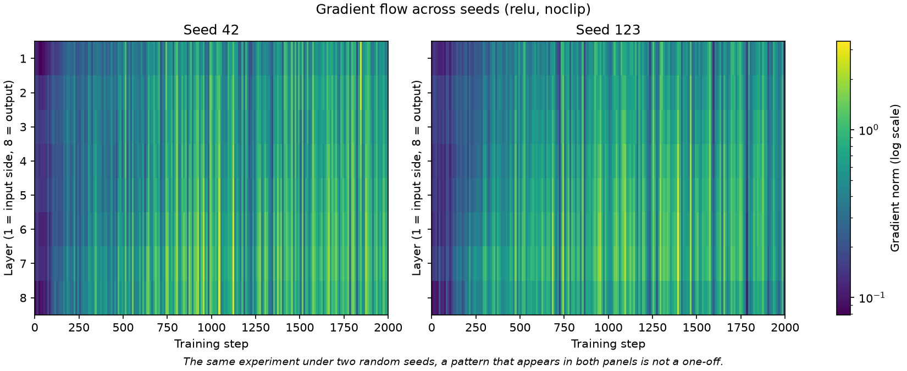

# bean-flow

Gradient-flow heatmaps for a deep MLP: where in the network does learning actually happen?

Loss curves show the outcome of a training run, a gradient heatmap shows the path. This project trains an 8-layer MLP on the Dry Bean dataset (7 classes), records the gradient norm of every layer every 10 training steps, and plots the resulting (steps x layers) matrix as a heatmap. It compares sigmoid and ReLU hidden layers, gradient clipping at max norm 1.0, and two random seeds.

## Reproduce

```bash
python -m venv .venv
source .venv/bin/activate
pip install -r requirements.txt
python run_experiments.py
```

One command runs all 8 experiments (2 activations x 2 clip settings x 2 seeds, about 12 seconds on a CPU), writes the raw numbers to `results/logs/`, the 12 heatmaps to `results/heatmaps/` and prints a summary. The first run downloads Dry Bean from UCI and caches it in `data/dry_bean.csv` (git-ignored). Running it twice gives byte-identical logs. Tested with Python 3.13.9, torch 2.15.0, numpy 2.5.4, pandas 3.1.0, matplotlib 3.11.2.

```
src/data.py         loading, split, standardization, seeded DataLoader
src/model.py        8-layer MLP, Xavier init, build_mlp(activation, seed)
src/diagnostics.py  per-layer gradient norms
src/train.py        training loop with recording and optional clipping, evaluate(), overfit_one_batch()
src/plotting.py     heatmaps (single and side by side on one shared color scale)
src/experiments.py  the experiment grid, the plots and the printed summary
run_experiments.py  entry point
```

## Design choices

**Data.** Dry Bean (UCI id 602): 13,611 beans, 16 numeric shape features, 7 classes. I chose it because it is tabular, large enough for stable gradient estimates and cleanly separable (about 92 to 93 % accuracy is typical). The features are standardized because their raw scales differ by orders of magnitude (`Area` is about 1e4, `Eccentricity` is below 1), which would otherwise dominate the first layer.

**Split.** 80 % train / 20 % test with `torch.utils.data.random_split` and a fixed split seed of 42, so every run uses the same split. There is no validation set because nothing is tuned: architecture, learning rate and clip threshold are fixed by the experiment design. Mean and standard deviation for standardization come from the train part only. The gradient norms are recorded on training batches only, accuracy is reported on the test set. `random_split` is not stratified; with 13.6k samples all 7 classes still appear in both parts (smallest class, Bombay: 427 train, 95 test).

**Architecture.** 8 `nn.Linear` layers: 16 -> 64 -> 64 -> 64 -> 64 -> 64 -> 64 -> 64 -> 7, i.e. 7 hidden layers with the activation and one output layer. The task asks for 8 layers, so the heatmap has exactly 8 rows. Width 64 is wide enough for the 16 input features while keeping the runs fast, and it is the same for every hidden layer so that differences between layers come from depth, not from layer size. The output layer returns raw logits, no softmax: `nn.CrossEntropyLoss` applies `log_softmax` internally (a second softmax would shrink the gradients and distort exactly what is measured here). Sigmoid belongs on the output layer of a binary classifier, not in the hidden layers of a deep network, which is the point of this comparison.

**Initialization.** Xavier-uniform weights and zero biases for both activations. Xavier keeps activation variance roughly constant for symmetric activations such as sigmoid. I deliberately use the same init for ReLU (for which Kaiming would be the textbook choice), so that the activation is the only thing that differs between the two settings. A Kaiming run for ReLU would be a natural follow-up.

**Optimization.** Plain SGD, learning rate 0.01, batch size 32, 2000 steps, no schedule. Optimizers are not part of this unit and Adam would hide the effect under study: it rescales every parameter's update, so layers with tiny gradients would still move. 2000 steps is about 6 epochs.

**Recording.** Every 10 steps the L2 norm of each layer's weight gradient is stored, giving a 200 x 8 matrix per run. Layer norms are recorded after clipping (what the optimizer actually uses). The global gradient norm before clipping is stored separately to show whether the threshold triggers.

**Clipping.** `clip_grad_norm_` with max norm 1.0, as prescribed by the task, applied only in the runs that study clipping. It rescales all gradients by one common factor when their global norm exceeds the threshold. I did not pick 1.0 to fit the model, so I measured how often it triggers (see below).

**Evaluation.** Accuracy is computed in `model.eval()` mode inside `torch.no_grad()`. Seed 42 is the default everywhere, the second seed is 123.

## Results

Test accuracy after 2000 steps (train accuracy in brackets, mean gradient norm per layer from layer 1 = input side to layer 8 = output, seed 42):

| Run | Test (train) accuracy | Layer 1 | Layer 4 | Layer 8 |
|---|---|---|---|---|
| Sigmoid | 26.1 % (26.0 %) | 4.6e-5 | 2.5e-3 | 0.67 |
| Sigmoid + clip 1.0 | 26.1 % (26.0 %) | 4.5e-5 | 2.4e-3 | 0.64 |
| ReLU | 91.7 % (92.6 %) | 0.51 | 0.64 | 0.79 |
| ReLU + clip 1.0 | 90.6 % (91.5 %) | 0.24 | 0.29 | 0.39 |

Seed 123 gives the same picture (sigmoid 26.1 %, ReLU 91.8 %, ReLU + clip 91.5 % test accuracy).

### Sigmoid vs ReLU



*Per-layer gradient norm during training for sigmoid and ReLU hidden layers, both panels share one color scale.*

With sigmoid, the gradient norm falls by roughly four orders of magnitude from layer 8 to layer 1 and the stripes stay constant over all 2000 steps. The last two layers carry about 93 % of the total gradient, layers 1 to 3 barely move. With ReLU, all layers receive gradients of the same order (layer 1 is about 0.64 to 0.71 times layer 8), with some per-batch spikes, and the gradients are weaker during the first 100 to 200 steps while the loss is still on its initial plateau.

The sigmoid network does not just learn slowly, it does not learn anything about the input. Its loss stays at about 1.83, which is the entropy of the class distribution (1.84), and it predicts the majority class (Dermason, 26 %) for every sample. That is why all sigmoid runs report the same accuracy: they all output the same constant class on the same test set. This is not a bug: the same code overfits a single batch to a loss of 0.001 with sigmoid, and raising the learning rate to 0.1 or training for 20,000 steps does not change the outcome. Seven stacked sigmoids squash the input signal on the forward pass as well, so the network can only learn the bias of its last layer.

### Gradient clipping



*Per-layer gradient norm without and with global-norm clipping, norms are measured after clipping and both panels share one color scale.*

Clipping changes the overall scale but not which layers receive gradient. For ReLU the per-layer norms are roughly halved (layer 1: 0.51 -> 0.24), while each layer's share of the total stays almost the same (layer 1: 9.3 % -> 9.3 %, layer 8: 14.6 % -> 15.2 %). For sigmoid the profile is practically identical (layer 8 carries 71.5 % without and 71.6 % with clipping), see `results/heatmaps/clipping_comparison_sigmoid_seed42.png`. This is what one expects from clipping by the global norm: one common factor for all layers. It cannot repair vanishing gradients, it can only shrink gradients.

How often the threshold triggers differs a lot. With sigmoid the global norm has a mean of about 0.7 and exceeds 1.0 in 11 to 12 % of the recorded steps. With ReLU the global norm grows during training (mean about 2.0, maximum about 6 to 7), and the threshold is exceeded in 81 to 84 % of recorded steps overall and in more than 94 % of the steps in the second half of training. So for ReLU a threshold of 1.0 does not just cut rare spikes, it acts like a permanent damping of the step size, which is consistent with the slightly lower test accuracy (90.6 % vs 91.7 % for seed 42, 91.5 % vs 91.8 % for seed 123; with two seeds I would not call that difference established).

### Two seeds



*The same experiment under two random seeds, a pattern that appears in both panels is not a one-off.*

The qualitative patterns repeat under the second seed: the four-order-of-magnitude staircase for sigmoid, the roughly even distribution for ReLU, the weak first 100 to 200 steps and the clipping behaviour (relative layer profile unchanged, norms scaled down). The batch-level spikes differ between seeds, as they should. All 12 figures are in `results/heatmaps/`, the sigmoid seed comparison is `seed_comparison_sigmoid_noclip.png`.

## What changed my mind

- **Sigmoid does not "train slowly", it collapses.** I expected the sigmoid network to learn, just worse. It converged to the class prior and ignores the input. The vanishing gradient shows up in the heatmap as the stripes, but the loss curve is what shows the consequence. Both views are needed.
- **Clipping at 1.0 is not a safety net here.** I expected a threshold like this to catch rare spikes. For ReLU it is active in more than four out of five steps, and because it scales all layers equally, it neither helps nor hurts the layer-to-layer balance, it only changes the effective learning rate.
- **A single heatmap is easy to over-read.** The per-batch stripes in the ReLU heatmaps look like structure, but they differ between seeds. The depth profile is what repeats.

## Data source

Dry Bean Dataset, UCI Machine Learning Repository, DOI [10.24432/C50S4B](https://doi.org/10.24432/C50S4B), licensed under [CC BY 4.0](https://creativecommons.org/licenses/by/4.0/). The data is not part of this repository, it is downloaded on the first run.

Original paper: Koklu, M. and Ozkan, I. A. (2020). Multiclass classification of dry beans using computer vision and machine learning techniques. *Computers and Electronics in Agriculture*, 174, 105507. DOI [10.1016/j.compag.2020.105507](https://doi.org/10.1016/j.compag.2020.105507).

## Limitations

- Two seeds and one train/test split; differences of a few tenths of a percent are not established.
- Fixed learning rate and number of steps. Sigmoid might learn with a different init (for example a smaller depth or tuned scale), which I did not explore. A shallower sigmoid network would be the natural control to show that depth is the cause.
- Same Xavier init for both activations on purpose; Kaiming for ReLU was not tested.
- `random_split` is not stratified, there is no validation set, and no hyperparameter was tuned.
- Dry Bean only; the Glass Identification dataset mentioned in the task was not used.
